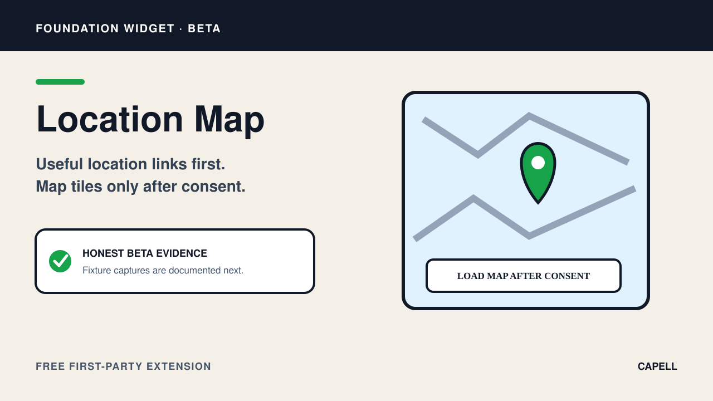
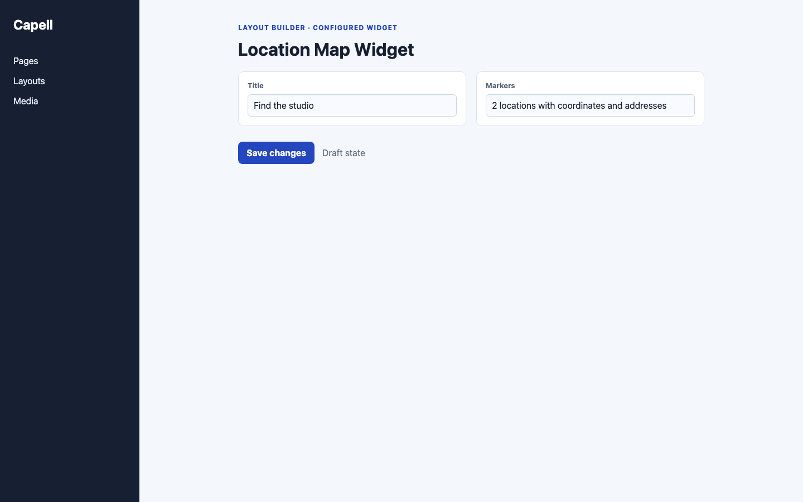

# Location Map Widget

<!-- prettier-ignore-start -->

## What This Plugin Adds

Location Map Widget is an **Available**, **No schema impact** Capell package in the **Capell Foundation** product group. It ships as `capell-app/widget-location-map` and extends these surfaces: admin, frontend.

Location Map adds a Layout Builder widget for validated place markers with ordinary OpenStreetMap links and an optional interactive embed. The embed is loaded only after explicit activation and can respect Privacy Center decisions.

Editors configure locations in Layout Builder, and visitors initially receive useful map links with the choice to activate the richer public map.

Evidence: [`src/Filament/LocationMapWidget.php`](src/Filament/LocationMapWidget.php), [`resources/views/widget.blade.php`](resources/views/widget.blade.php), [`tests/Feature/WidgetLocationMapTest.php`](tests/Feature/WidgetLocationMapTest.php), [`capell.json`](capell.json).

Status details:

- Status: Available
- Tier: free
- Bundle: foundation
- Composer package: `capell-app/widget-location-map`
- Namespace: `Capell\WidgetLocationMap`
- Theme key: not applicable

## Why It Matters

**For developers:** The widget validates marker data and keeps third-party map loading behind an interaction and privacy-aware extension boundary.

**For teams:** Teams can publish useful location details before asking visitors to load an external map experience.

Evidence: [`src/Providers/WidgetLocationMapServiceProvider.php`](src/Providers/WidgetLocationMapServiceProvider.php), [`src/Filament/LocationMapWidget.php`](src/Filament/LocationMapWidget.php), [`tests/Feature/WidgetLocationMapTest.php`](tests/Feature/WidgetLocationMapTest.php), [`resources/views/widget.blade.php`](resources/views/widget.blade.php).

## Screens And Workflow

Screenshot contract: `docs/screenshots.json`.

- Location Map Widget extension card (marketplace, required).
- Location Map fields in Layout Builder (admin, optional).
- Location Map public output (frontend, optional).

## Technical Shape

- Service providers: `Capell\WidgetLocationMap\Providers\WidgetLocationMapServiceProvider`.
- Filament classes: `LocationMapWidget`.
- Data objects: `LocationMapInputData`, `LocationMapRenderData`, `LocationMarkerData`.
- Manifest contributions: `content-widget: Capell\WidgetLocationMap\WidgetLocationMapContribution`.
- Health checks: `Capell\WidgetLocationMap\Health\WidgetLocationMapHealthCheck`.
- Blade views: `packages/widget-location-map/resources/views/widget.blade.php`.
- Cache tags: `widget-location-map`.

## Data Model

This package has no schema impact. It extends Capell through `content-widget` contributions instead of declaring package-owned tables.

## Install Impact

- Required packages: `capell-app/admin`, `capell-app/core`, `capell-app/frontend`, `capell-app/layout-builder`.
- Admin navigation: no admin page or resource contribution is declared.
- Admin/editor extensions: `content-widget: WidgetLocationMapContribution`.
- Permissions: none declared in `capell.json`.
- Public routes: none declared.
- Database changes: no package migrations declared.
- Config: no package config files.
- Settings: no package settings declared.
- Queues or schedules: none declared.
- Cache tags: `widget-location-map`.
- Commands: none declared.

## Common Pitfalls

- Keep required Capell packages on compatible v4 releases: `capell-app/admin`, `capell-app/core`, `capell-app/frontend`, `capell-app/layout-builder`.
- Keep public Blade and cached HTML free of authoring markers, model IDs, permissions, signed editor URLs, and lazy database queries.
- Custom write integrations must preserve invalidation for `widget-location-map` cache tags.

## Troubleshooting

| Symptom | Likely cause | Check | Fix |
| --- | --- | --- | --- |
| Package surface is missing after install | Provider or manifest is not loaded | Confirm `capell.json`, package `composer.json`, and provider registration | Reinstall the package, refresh Composer autoload, and clear host caches |
| Public output leaks unexpected state | Render data, cache variation, or authoring boundary has regressed | Check public Blade, cache tags, and public-output safety tests | Move data loading out of Blade and rerun the package public-output tests |

## Quick Start

1. Install the package: `composer require capell-app/widget-location-map`.
2. No package-specific setup command or migrations are declared.
3. Open the package detail or install-intent surface and confirm the Location Map Widget extension card is present.

## Next Steps

- [Package docs](docs/README.md)
- [Overview](docs/overview.md)
- [Troubleshooting](#troubleshooting)
- [Screenshot contract](docs/screenshots.json)
- [Marketplace assets](docs/assets/marketplace/)
- [Capell content language plan](../../docs/CONTENT_LANGUAGE_PLAN.md)
- [Capell documentation design system](../../docs/DESIGN_SYSTEM.md)
- [Capell and package ERD notes](../../docs/erd/capell-and-package-erds.md)
- Related packages: [Layout Builder](../layout-builder/README.md), [Privacy Center](../privacy-center/README.md).
- Focused tests: `vendor/bin/pest packages/widget-location-map/tests --configuration=phpunit.xml`.

<!-- prettier-ignore-end -->
