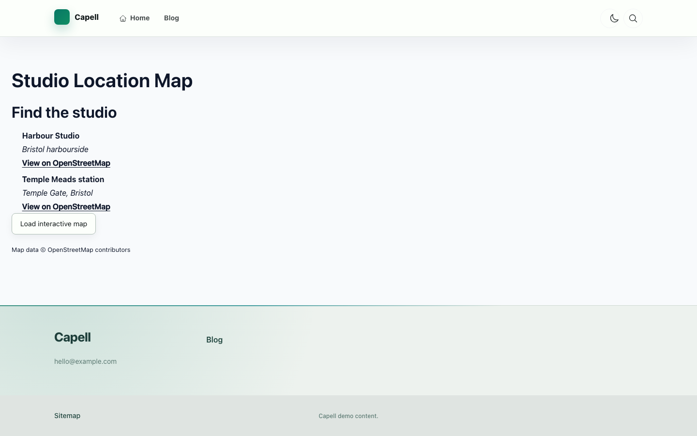
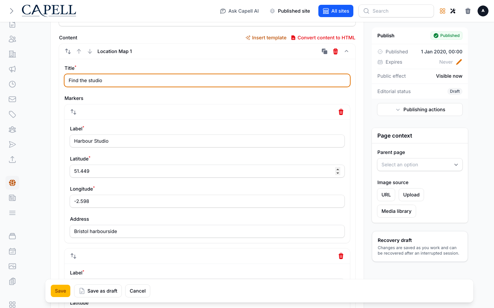

# Location Map Widget

<!-- prettier-ignore-start -->

## What It Does

Location Map adds a Layout Builder widget for validated place markers with ordinary OpenStreetMap links and an optional interactive embed. The embed is loaded only after explicit activation and stays blocked when Privacy Centre records that the visitor refused functional cookies.

- **Price and availability:** Check current availability and price on the [Capell Marketplace listing](https://capell.app/extensions/widget-location-map).
- **Licence:** Check the licence terms on the [Capell Marketplace listing](https://capell.app/extensions/widget-location-map).
- **Requires:** `PHP ^8.4`, `capell-app/admin ^1.0`, `capell-app/core ^1.0.66`, `capell-app/frontend ^1.0`, `capell-app/layout-builder ^1.0`, `spatie/laravel-package-tools ^1.0`.
- **Install:** `composer require capell-app/widget-location-map`.

Editors configure locations in Layout Builder, and visitors initially receive useful map links with the choice to activate the richer public map.

## Who It Is For

**For developers:** The widget validates marker data and keeps third-party map loading behind an interaction and privacy-aware extension boundary.

**For teams:** Teams can publish useful location details before asking visitors to load an external map experience.

## Quick Start

1. Install the package: `composer require capell-app/widget-location-map`.
2. Open a page, click **Layout builder**, **Add widgets**, then choose **Location Map**.

## Configure

This extension works without configuration. There is nothing to set after install.

## Limits And Pitfalls

- Install the required Capell packages at the versions in `composer.json`: `capell-app/admin ^1.0`, `capell-app/core ^1.0.66`, `capell-app/frontend ^1.0`, `capell-app/layout-builder ^1.0`.
- Keep public Blade and cached HTML free of authoring markers, model IDs, permissions, signed editor URLs, and lazy database queries.
- Custom write integrations must preserve invalidation for `widget-location-map` cache tags.

## Screens And Workflow

- Location Map Widget extension card (marketplace).
- Location Map fields in Layout Builder (admin).
- Location Map public output (frontend).
- Location Map fields in Layout Builder with admin sidebar menu open (admin).

## Install Impact

- Required packages: `capell-app/admin`, `capell-app/core`, `capell-app/frontend`, `capell-app/layout-builder`.
- Admin navigation: no admin page or resource contribution is declared.
- Admin/editor extensions: `content-widget: WidgetLocationMapContribution`.
- Permissions: no package permission declarations or Shield gates detected; host access rules still apply.
- Public routes: none declared.
- Database changes: no package migrations declared.
- Config: no package config files.
- Settings: no package settings declared.
- Queues or schedules: none declared.
- Cache tags: `widget-location-map`.
- Commands: none declared.

## Troubleshooting

| Symptom | Likely cause | Check | Fix |
| --- | --- | --- | --- |
| Package surface is missing after install | Provider or manifest is not loaded | Confirm `capell.json`, package `composer.json`, and provider registration | Reinstall the package, refresh Composer autoload, and clear host caches |
| Public output leaks unexpected state | Render data, cache variation, or authoring boundary has regressed | Check public Blade, cache tags, and public-output safety tests | Move data loading out of Blade and rerun the package public-output tests |
| The map is refused | It has no markers or more than 20 | Count the markers | Keep between 1 and 20 markers |
| A marker is refused | Latitude is outside -90 to 90, longitude is outside -180 to 180, or the label is empty | Check the marker's latitude, longitude and label | Enter decimal degrees such as 51.5072 and -0.1276 |

## Upgrading

No manual steps between minor versions.

## Next Steps

- [Package docs](docs/README.md)
- [Overview](docs/overview.md)
- [Troubleshooting](#troubleshooting)
- [Developer reference](docs/reference.md)
- [Marketplace assets](docs/assets/marketplace/)
- [Capell content language plan](../../docs/CONTENT_LANGUAGE_PLAN.md)
- [Capell documentation design system](../../docs/DESIGN_SYSTEM.md)
- [Capell and package ERD notes](../../docs/erd/capell-and-package-erds.md)
- Related packages: [Layout Builder](../layout-builder/README.md), [Privacy Centre](../privacy-center/README.md).

<!-- prettier-ignore-end -->
